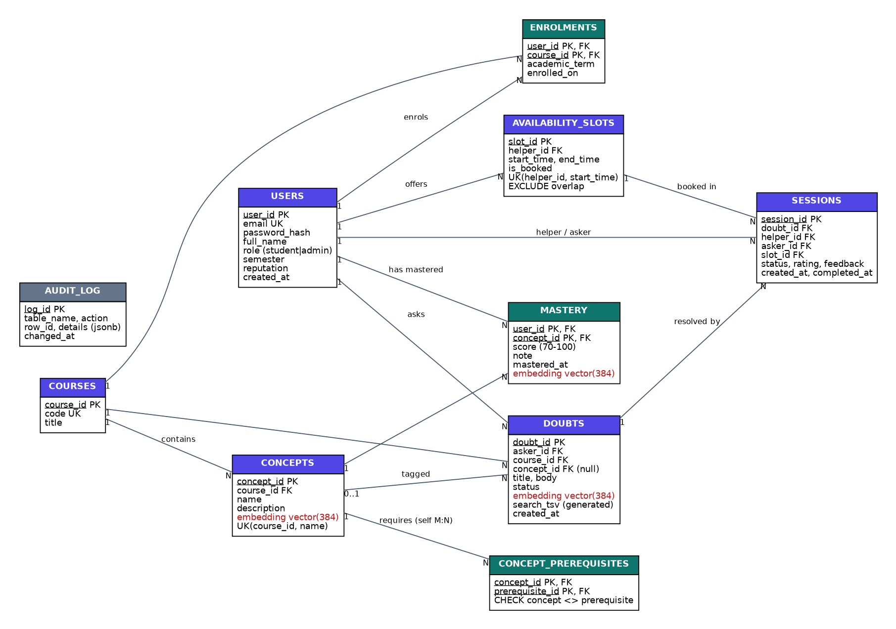
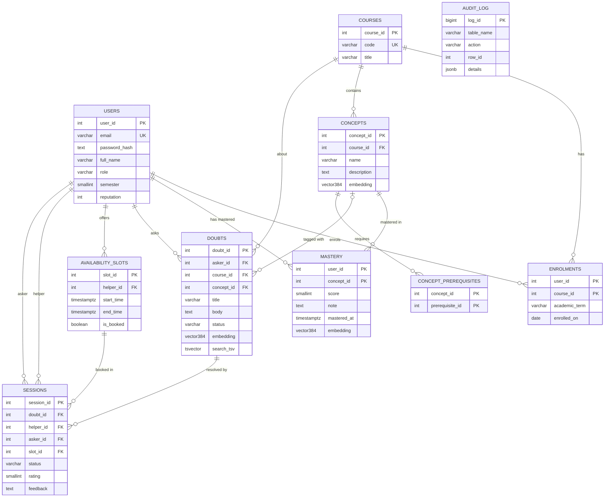

# PeerBridge - Semantic Peer Doubt Resolution

**Course:** DBMS Experiential Learning, Level 3
**Project no.:** 30 &nbsp;|&nbsp; **Team:** Saikavin S (PES1UG24CS402), S. Hemanth Kumar (PES1UG24CS418)
**Section:** _<your section>_ &nbsp;|&nbsp; **Repo:** _<GitHub URL>_

> Before submitting: fill the two italic placeholders, then replace the screenshots in `docs/screenshots/` with ones taken on your machine using the real embedding model (see Section 11).

---

## 1. Objectives

Students' doubts often go unresolved because help is limited to their own batch or section. PeerBridge:

1. Matches a doubt, by **meaning**, to peers who **recently mastered** the same concept, regardless of batch.
2. Lets helpers publish availability slots and lets askers book them safely, even under concurrent use.
3. Rewards helpers with reputation and gives administrators visibility into demand versus supply of expertise.
4. Demonstrates practical use of **PostgreSQL** (transactional data) together with **pgvector** (semantic search), going well beyond CRUD.
5. Enforces **role-based access control inside the database itself** (PostgreSQL roles, column privileges, row-level security), not only in the application.
6. Builds a **learning path** for each doubt: a recursive query over a concept-prerequisite graph tells the asker which foundations to study first.

## 2. Functional requirements

| # | Requirement | Role |
|---|---|---|
| F1 | Register / log in / log out with hashed passwords and JWT cookie | all |
| F2 | Enrol in / leave courses | student |
| F3 | Post a doubt; it is embedded and auto-tagged to the nearest concept in the course | student |
| F4 | View ranked peer matches for own doubt (semantic + recency + reputation) | student |
| F5 | Record concepts mastered (score, own-words note) and offer help slots | student |
| F6 | Book a slot with a matched peer (transactional, race-safe) | student |
| F7 | Complete (with rating) or cancel a session | student |
| F8 | Full-text search over other students' open doubts | student |
| F9 | Admin dashboard: platform stats, helper leaderboard, supply gaps, unserved doubts, audit log, moderation | admin |
| F10 | Edit an open doubt; its embedding is recomputed and the concept re-tagged | student |
| F11 | Semantic search (by meaning) and keyword search over other students' open doubts | student |
| F12 | Learning path for a doubt (recursive prerequisite walk) and "others asking something similar" | student |
| F13 | Admin curates the concept-prerequisite graph; cycles and cross-course edges are rejected by the database | admin |

## 3. ER diagram



_(Source: `docs/er_diagram.dot`; vector columns in red; the same model in Mermaid below.)_



`ENROLMENTS` resolves the M:N between users and courses. `MASTERY` resolves the M:N between users and concepts and carries its own attributes. `CONCEPT_PREREQUISITES` is a self-referencing M:N on `concepts` (a directed acyclic graph). `AUDIT_LOG` is written only by triggers, so it has no foreign keys.

## 4. Relational schema

```
users(user_id PK, email UNIQUE, password_hash, full_name, role, semester, reputation, created_at)
courses(course_id PK, code UNIQUE, title)
concepts(concept_id PK, course_id FK->courses, name, description, embedding)      UNIQUE(course_id, name)
concept_prerequisites(concept_id FK->concepts, prerequisite_id FK->concepts)       PK(concept_id, prerequisite_id), CHECK concept_id <> prerequisite_id
enrolments(user_id FK->users, course_id FK->courses, academic_term, enrolled_on)  PK(user_id, course_id)
mastery(user_id FK->users, concept_id FK->concepts, score, note, mastered_at, embedding)  PK(user_id, concept_id)
doubts(doubt_id PK, asker_id FK->users, course_id FK->courses, concept_id FK->concepts NULL,
       title, body, status, embedding, search_tsv GENERATED, created_at)
availability_slots(slot_id PK, helper_id FK->users, start_time, end_time, is_booked)  UNIQUE(helper_id, start_time)
sessions(session_id PK, doubt_id FK->doubts, helper_id FK->users, asker_id FK->users, slot_id FK->availability_slots,
         status, rating, feedback, created_at, completed_at)
audit_log(log_id PK, table_name, action, row_id, details, changed_at)
```

The schema is in **3NF/BCNF**: every non-key attribute depends on the key, the whole key, and nothing but the key. `users.reputation` is a deliberate, trigger-maintained derived value (kept for fast ranking); it is the only controlled denormalisation.

## 5. Database choice and justification

| Data | Store | Why |
|---|---|---|
| Users, enrolments, courses, doubts, slots, sessions | **PostgreSQL** (relational) | Strongly structured, many relationships, needs ACID transactions (two students must never book the same slot), constraints and triggers. |
| Semantic vectors of doubts, concepts and mastery notes | **pgvector** (inside the same PostgreSQL) | The core matching is *similarity of meaning*, which keyword or batch filters cannot do. Keeping vectors **in the same database** lets one SQL query join similarity with relational filters (free slots, not-the-asker, reputation) and keeps vectors and rows consistent in one transaction. A separate vector store would force a second system and application-side joins. |

The **prerequisite graph** is stored relationally as an edge table and traversed with a recursive CTE. It is small (tens of edges per course), needs referential integrity and cycle checks inside the same transactional database, and is joined with mastery data in one query, so a separate graph database (Neo4j) would add a second system without a benefit at this scale.

Why not NoSQL (MongoDB / Neo4j)? The data is relational and transaction-heavy; document or graph models would add no value and would lose constraints. This follows the requirement to justify each store by the nature of the data.

## 6. Data dictionary

| Table | Column | Type | Constraints / meaning |
|---|---|---|---|
| users | user_id | SERIAL | PK |
| | email | VARCHAR(255) | UNIQUE, NOT NULL, regex format CHECK |
| | password_hash | TEXT | bcrypt hash |
| | full_name | VARCHAR(120) | NOT NULL, trimmed length >= 2 |
| | role | VARCHAR(10) | CHECK in ('student','admin') |
| | semester | SMALLINT | CHECK 1-8 |
| | reputation | INT | CHECK >= 0, maintained by trigger |
| courses | code | VARCHAR(12) | UNIQUE |
| concepts | embedding | vector(384) | embedding of "name. description" |
| concept_prerequisites | concept_id / prerequisite_id | INT | composite PK, both FK to concepts; CHECK different; trigger: same course, no cycle |
| enrolments | academic_term | VARCHAR(10) | default '2026-ODD' |
| mastery | score | SMALLINT | CHECK 70-100 (mastery threshold) |
| | note | TEXT | CHECK trimmed length >= 10; helper's own words |
| | mastered_at | TIMESTAMPTZ | drives the recency weight |
| | embedding | vector(384) | embedding of "concept. description. note" |
| doubts | title / body | VARCHAR(200) / TEXT | CHECK length >= 8 / >= 20 |
| | status | VARCHAR(10) | open, matched, resolved, cancelled |
| | embedding | vector(384) | embedding of "title. body" |
| | search_tsv | tsvector | GENERATED ALWAYS ... STORED, for full-text search |
| availability_slots | start_time / end_time | TIMESTAMPTZ | CHECK end > start, length <= 2 h; EXCLUDE overlap per helper |
| | is_booked | BOOLEAN | maintained by trigger |
| sessions | status | VARCHAR(10) | scheduled, completed, cancelled |
| | rating | SMALLINT | CHECK 1-5, only when completed |
| | (constraint) | | CHECK helper <> asker; partial UNIQUE: one active session per doubt and per slot |
| audit_log | details | JSONB | row snapshot without embeddings |

## 7. Database implementation

### 7.1 DDL (`db/01_schema.sql`, `db/demo/ddl_demo.sql`)
`CREATE EXTENSION vector, btree_gist`; `CREATE TABLE` with PK, FK (with `ON DELETE CASCADE / RESTRICT / SET NULL` chosen per relationship), `CHECK`, `UNIQUE`, and `EXCLUDE USING gist` constraints; `ALTER TABLE` (add / rename / drop column, add constraint) and `DROP INDEX / TABLE` in `ddl_demo.sql`.

### 7.2 Advanced SQL features (requirement: at least four)

| # | Feature | Where |
|---|---|---|
| 1 | **Transactions** with row locks (`SELECT ... FOR UPDATE`) | `sp_book_session`, called inside `BEGIN ... COMMIT` by `POST /api/sessions`; proven by the concurrency test T30 |
| 2 | **Triggers** (8) | enrolment validation, booking validation, state sync, reputation, slot release, audit, prerequisite cycle check |
| 3 | **Stored functions** | `fn_find_peers(doubt_id, limit)` (CTE + vector search), `fn_learning_path(doubt_id)` (**recursive CTE**) |
| 4 | **Stored procedures** | `sp_book_session(...)`, `sp_complete_session(id, rating, feedback)` |
| 5 | **Views** (5) | `v_open_doubts`, `v_helper_leaderboard`, `v_concept_demand_supply`, `v_platform_stats`, `v_unserved_doubts` (**correlated** `NOT EXISTS`) |
| 6 | **CTEs** | recursive: `fn_learning_path`, `fn_validate_prereq`; non-recursive: `fn_find_peers`, demand/supply query |
| 7 | **Indexing** | B-tree, partial (`WHERE NOT is_booked`), GIN, HNSW |
| 8 | **Full-text search** | generated `tsvector` + GIN, `websearch_to_tsquery`, `ts_rank`, `ts_headline` |
| 9 | **Vector similarity search** | `embedding <=> $1::vector` with HNSW |
| 10 | **Roles, GRANT, row-level security** | `db/04_roles_rls.sql` (Section 7.5) |

### 7.3 Triggers

| Trigger | Fires | Purpose |
|---|---|---|
| trg_validate_mastery | BEFORE INSERT/UPDATE mastery | user must be enrolled in the concept's course |
| trg_validate_doubt | BEFORE INSERT doubts | asker enrolled; concept belongs to the course |
| trg_validate_session | BEFORE INSERT sessions | slot belongs to helper, free, in the future; asker owns an open doubt |
| trg_session_created | AFTER INSERT sessions | slot -> booked, doubt -> matched |
| trg_session_before/after_update | UPDATE sessions | stamp `completed_at`; forbid illegal transitions; completed -> doubt resolved and helper gets `10 + 2 x rating` reputation; cancelled -> slot freed, doubt re-opened |
| trg_session_deleted | AFTER DELETE sessions | free the slot |
| trg_audit_doubts / trg_audit_sessions | AFTER I/U/D | write JSONB snapshot to `audit_log` |
| trg_validate_prereq | BEFORE INSERT/UPDATE concept_prerequisites | prerequisite must be in the same course; rejects cycles using a recursive CTE |

Trigger functions that must touch rows the caller does not own (`fn_session_created` flips the *helper's* slot, `fn_session_after_update` credits the helper's reputation, `fn_audit` writes the log) are `SECURITY DEFINER` with a fixed `search_path`; every other function runs with the caller's privileges.

### 7.4 Vector / semantic search design (requirement 8)

| Question | Answer |
|---|---|
| What is embedded? | Doubts (`title. body`), concepts (`name. description`), and each helper's mastery note (`concept. description. their own note`). |
| Which model? | `all-MiniLM-L6-v2` sentence transformer, run locally with Transformers.js; mean pooling, L2-normalised, **384 dimensions**. Chosen because it is small, free, offline and good at short English text. |
| How are vectors stored? | `vector(384)` columns in PostgreSQL via pgvector. |
| Index | HNSW with `vector_cosine_ops` on `mastery`, `doubts`, `concepts`. |
| Similarity metric | **Cosine distance** (`<=>`); similarity = `1 - distance`. Vectors are normalised, so this equals the dot product. |
| Retrieval strategy | 1) nearest 50 mastery vectors to the doubt; 2) best concept per peer; 3) re-rank with `0.70 sim + 0.20 recency + 0.10 reputation`; 4) drop peers with no free future slot; 5) return top 5. |
| Recency | `exp(-age_days / 30)`; mastering a topic last week scores far higher than last term. |
| Auto-tagging | New doubt is compared with the concept embeddings of its course; the nearest concept is attached if cosine similarity >= 0.25. |
| Metadata | Relational columns next to each vector (course, concept, asker, mastered_at, status) are used for filtering and ranking in the same query. |

#### Vector data: create, read, update, delete

| Operation | Feature | Implementation |
|---|---|---|
| **Create** | Post a doubt; record a mastery note | embedding computed in the API, stored with `INSERT ... $n::vector` |
| **Read** | Peer matching; semantic search; "similar doubts"; auto-tagging | `ORDER BY embedding <=> $1::vector LIMIT k` (HNSW) in `fn_find_peers`, `GET /api/doubts?mode=semantic`, `GET /api/doubts/:id/similar` |
| **Update** | Edit a doubt; refresh a mastery note | `PATCH /api/doubts/:id` and `POST /api/mastery` recompute the embedding and `UPDATE` it; the HNSW entry is updated; the concept is re-tagged; the peer ranking changes (API test V07) |
| **Delete** | Delete a doubt; remove a mastery | `DELETE` removes the row and its vector from the HNSW index together |

### 7.5 Role-based access control in the database (`db/04_roles_rls.sql`)

| Role | Kind | What it can do |
|---|---|---|
| `pb_app` | LOGIN, used by Next.js | **no table privileges**; may only `SET ROLE` to the three roles below (`INHERIT FALSE`) |
| `pb_auth` | NOLOGIN | read `users` for login; `INSERT` only `(email, password_hash, full_name, semester)`, an RLS policy forces `role='student'` |
| `pb_student` | NOLOGIN | least privilege: reads reference data and public profile columns (no e-mail, no password hash); manages only **own** enrolments, mastery, doubts, slots; cannot set `doubts.status`, `slots.is_booked` or insert sessions directly |
| `pb_admin` | NOLOGIN | read every table (except password hash) and the audit log; delete doubts; edit the prerequisite graph; cannot create doubts |

Every API request runs as `BEGIN; SET LOCAL ROLE pb_student|pb_admin; SELECT set_config('app.user_id', ...); ...; COMMIT;` (`lib/db.ts`). **Row-level security** policies then use `fn_current_user_id()`:

| Table | Student sees / changes |
|---|---|
| doubts | own doubts + other students' *open* doubts; edit / delete only own and only while open |
| sessions | only sessions where he is asker or helper |
| mastery | everyone's rows readable (they are the public helper profile); only own rows writable |
| enrolments | own rows only |
| availability_slots | all readable (needed to book); insert / delete only own free slots |
| audit_log | no access (admin only) |

Because the rules live in PostgreSQL, a bug or SQL injection in the web tier still cannot exceed the caller's role. Evidence: tests T11-T27 (database) and A05-A08 (API). Admin accounts exist only via the seed script, never through registration.

*Limitation (stated honestly):* `app.user_id` is a session setting made by the trusted API server; a client with direct SQL access as `pb_student` could set it themselves. The database is not exposed to browsers, so the API is the only path; per-user login roles would be the next step.

## 8. Important queries

See `db/demo/demo_queries.sql` for runnable versions.

| Query | Concepts shown |
|---|---|
| Q1 open doubts with course and asker | JOIN, ORDER BY |
| Q2 concepts with at least 2 helpers | GROUP BY, HAVING, AVG |
| Q3 students above-average mastery count | subquery |
| Q4 helper rank within course | window function `RANK() OVER (PARTITION BY ...)` |
| Q5 full-text search "page fault" | tsvector, `ts_rank` |
| Q6 nearest mastery notes to a doubt | pgvector `<=>` |
| Q7 `fn_find_peers(1, 5)` | stored function |
| Q8 platform stats / leaderboard / demand-supply | views |
| Q9 booking transaction with ROLLBACK | transaction, row lock |
| Q10 failing inserts | constraint and trigger proofs |
| Q11 prerequisites of "Deadlocks" at any depth | **recursive CTE** |
| Q12 doubts nobody can serve | **correlated subquery** (`NOT EXISTS`) |
| Q13 helper average rating vs overall | correlated scalar subqueries |
| Q14 demand vs supply per concept | non-recursive **CTEs** |
| Q15 role demo | `SET ROLE`, permission errors, RLS |
| Q16 vector read / update / delete | pgvector |

## 9. System architecture

```
 Browser (Next.js pages, React)
        |  fetch (JSON, httpOnly JWT cookie)
        v
 Next.js Route Handlers  (/api/*)   <- middleware.ts: page guard
   |  lib/auth.ts   : JWT verify, role check on every request (front/back-end authentication)
   |  lib/embed.ts  : Transformers.js  all-MiniLM-L6-v2  (in-process)
   |  lib/db.ts     : pg pool; per request: BEGIN, SET LOCAL ROLE, set_config('app.user_id'), COMMIT
        |  SQL over TCP as the restricted login role pb_app (credentials from .env)
        v
 PostgreSQL 16 + pgvector
   roles + GRANT + row-level security, tables, constraints, triggers,
   functions, procedures, views, HNSW / GIN indexes
```

Authentication: bcrypt password hashes, signed JWT in an httpOnly cookie, verified in `middleware.ts` (pages) and `requireSession()` (API). Authorization is enforced twice: in the API (HTTP 403) and in the database (Section 7.5). Credentials and the JWT secret come from `.env`; no secret is in the source.

## 10. Data validation and integrity

Validation is implemented **in the database**, so no client can bypass it: CHECK constraints (score range, rating range, length, email format, slot order and length), UNIQUE and partial-UNIQUE indexes, FK integrity, an EXCLUDE constraint against overlapping slots, and triggers for cross-table rules (enrolment, ownership, state transitions). The API maps PostgreSQL error codes (`23505`, `23514`, `23P01`, `P0001`, ...) to HTTP 4xx responses carrying the database's message. Consistency between sessions, slots and doubts is maintained by triggers and by the booking transaction. Access rules are enforced by PostgreSQL roles, column privileges and row-level security.

## 11. Application screenshots

Captured automatically by `scripts/screenshots.py` (files in `docs/screenshots/`). **The included images were taken with a stand-in embedder because the build sandbox cannot download the model, so match percentages look low; please re-capture them on your machine after `npm run seed` with the real model (`python scripts/screenshots.py`) and keep these captions.**

| Figure | File | Shows |
|---|---|---|
| 1 | `01_login.png` | Login / registration |
| 2 | `02_dashboard.png` | Student dashboard |
| 3 | `03_my_doubts.png` | My doubts, ask a new doubt |
| 4 | `04_doubt_matches.png` | Learning path (recursive), ranked peers with slots, similar doubts, edit |
| 5 | `05_browse_keyword.png` | Keyword (full-text) search with highlighted terms |
| 6 | `06_browse_semantic.png` | Semantic (vector) search with similarity % |
| 7 | `07_expertise.png` | My expertise (mastery notes, edit / remove) |
| 8 | `08_sessions.png` | Sessions: complete with rating / cancel |
| 9 | `09_admin_dashboard.png` | Admin: stats, leaderboard, unserved doubts, prerequisites, audit log |

## 12. Testing results

Two automated suites run against PostgreSQL 16 + pgvector 0.6 with the seeded data. Full logs: `docs/test_results/db_tests.txt` and `docs/test_results/api_tests.txt`. Re-run with `npm run test:db` and `npm run test:api` (API suite needs the app running).

**Result: 44 / 44 database tests and 44 / 44 API tests passed.** The semantic checks in the API suite (auto-tagging, search by meaning, ranking change after editing a doubt) were executed in the build sandbox with a stand-in embedder; **re-run `npm run test:api` on your machine with the real model and keep the new log.**

### Database suite (`scripts/test_db.mjs`, runs as `pb_app` + `SET ROLE`)

| IDs | What is proven |
|---|---|
| T01-T10 | CHECK / EXCLUDE / trigger rejections: mastery score, enrolment rule, overlapping and over-long slots, bad e-mail, helper = asker, rating range, **prerequisite cycle (recursive CTE trigger)**, cross-course and self prerequisite |
| T11-T27 | **RBAC**: no privileges without a role; password hash and e-mail unreadable by students; audit log hidden; row-level security on sessions, doubts, mastery; column privilege stops writing `status` / `is_booked`; direct session insert blocked; students cannot edit the prerequisite graph; admin can read audit and all sessions but cannot create doubts |
| T28-T33 | `sp_book_session` + triggers; booking someone else's doubt blocked; **two concurrent bookings of one slot: the second waits on the row lock then fails with PB409**; cancel frees slot and reopens doubt; helper cannot complete own session; completion with rating 5 gives reputation +20 |
| T34-T41 | `fn_learning_path` (**recursive CTE**), `v_unserved_doubts` (**correlated subquery**), `fn_find_peers` ranking, refusal for non-asker, **HNSW index used**, full-text search, JOIN + GROUP BY + HAVING |
| T42-T43 | admin delete writes an audit row (trigger); DDL demo (CREATE / ALTER / DROP) executes |

### API suite (`scripts/test_api.mjs`)

| IDs | What is proven |
|---|---|
| A01-A11 | wrong password 401; no cookie 401; page redirect; `/me`; student blocked from admin API (403); admin stats; admin cannot ask doubts (database role); **registration cannot create an admin**; invalid / duplicate e-mail |
| V01-V12 | vector **C**reate (embed + auto-tag), **R**ead (matches, semantic search, keyword search, similar doubts), **U**pdate (PATCH re-embeds, ranking changes; others cannot edit), **D**elete (others cannot delete; owner can) |
| M01-M05 | mastery upsert, refresh, score check, enrolment trigger, delete |
| B01-B11 | booking transaction, conflict 409 for same slot / doubt, outsider cannot cancel, helper cannot complete, rating validation, reputation +20, session lists restricted by RLS |
| R01-R04 | recursive learning path over HTTP; admin cycle and cross-course rejections; valid prerequisite |
| D01 | admin moderation + audit trigger |

Also verified: `next build` compiles with no type errors.

## 13. Conclusion

PeerBridge connects database concepts to a working web application: a normalised relational schema with rich constraints, trigger-enforced business rules, an ACID booking transaction, stored routines, views, and several index types, combined with pgvector so that peers are found by the **meaning** of a doubt. Choosing pgvector inside PostgreSQL, rather than a separate vector store, keeps semantic and relational data consistent and lets a single query combine similarity with availability and reputation.

**Possible extensions:** a hybrid ranking that blends full-text and vector scores, notifications, a feedback loop that re-weights helpers by past rating, and per-user database login roles instead of a session setting.

## Appendix A. Mapping to the evaluation rubric

| Rubric item (marks) | Evidence |
|---|---|
| ER diagram (2) | Section 3, `docs/er_diagram.png` |
| Relational schema with keys, relationships, constraints (3) | Sections 4 and 6 |
| SQL DDL with constraints (4) | `db/01_schema.sql`, `db/demo/ddl_demo.sql`; T43 |
| NoSQL / Vector creation (4) | `vector(384)` columns, HNSW indexes, Section 7.4 |
| Technology justification (1) | Section 5 |
| DML operations (4) | `db/demo/demo_queries.sql`, `seed.mjs`, every API route; tests M01-M05, V01-V12 |
| Nested / correlated / recursive / join queries (4) | Q3 (nested), **Q12-Q13 (correlated)**, **Q11 (recursive)**, Q1-Q2 joins |
| Procedure / function, trigger, CTE (6) | `sp_book_session`, `sp_complete_session`, `fn_find_peers`, `fn_learning_path`, 8 triggers, recursive and plain CTEs |
| NoSQL / Vector feature RUD (7) | Section 7.4 table; V01-V12, M01-M05 |
| Next.js interface (3) | Section 11 |
| Backend / API and DB integration (2) | Section 9, `app/api/*`, `lib/db.ts` |
| Authentication and RBAC in database (4) | Section 7.5, `db/04_roles_rls.sql`, T11-T27, A01-A09 |
| Documentation, Git/GitHub (2) | this report, `README.md`, `docs/CONTRIBUTIONS.md` |
| Originality, individual contribution (4) | `docs/CONTRIBUTIONS.md`, `docs/VIVA_PREP.md` |
